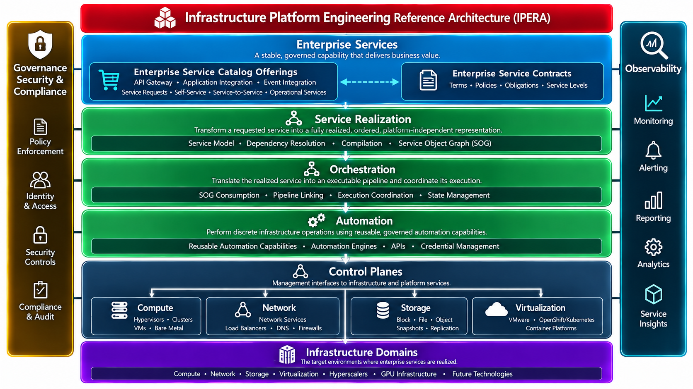

# OpenIPERA
## Open Infrastructure Platform Engineering Reference Architecture

**OpenIPERA models the system. Orchestration and automation operate the system.**

## What OpenIPERA Is — and What It Is Not

**OpenIPERA is not another workflow engine, automation framework, or sophisticated way to construct and manage predefined workflows using platforms such as Ansible Automation Platform (AAP), Spacelift, or similar technologies.**

OpenIPERA addresses a fundamentally different problem: how to represent, preserve, validate, and operationalize the knowledge required to deliver and sustain IT services.

Infrastructure automation has become increasingly sophisticated. Yet the knowledge governing what must be automated, why, in what order, under which policies, and subject to which operational obligations remains fragmented across people, documentation, service catalogs, scripts, and technology platforms.

We have become very good at automating individual activities without necessarily understanding the complete system those activities serve.

**OpenIPERA separates knowledge of the system from the mechanisms used to operate it.**

## The Fundamental Idea

Consider what happens when an IT Operations organization receives a new business requirement. Before it becomes an operational service, the organization must determine:

- Which services and infrastructure capabilities are required?
- What dependencies exist between them?
- Which approvals, policies, and organizational obligations must be satisfied?
- Which operational obligations must be satisfied, and what dependencies constrain their realization?
- Which requirements can be satisfied concurrently?
- How will the resulting service be validated?
- How will monitoring, logging, status, security, and compliance be established?
- What conditions must remain satisfied throughout the service's operational life?

These are not simply workflow steps. They represent the collective knowledge, dependencies, and contractual obligations governing the operational system.

**The Service Object Graph (SOG) is a mathematical representation of everything an IT Operations organization must accomplish and sustain to fully operationalize a new business need.**

It makes explicit **what must be true, what must happen, and what must remain true** for a service to exist and operate successfully.

The SOG is not an automation script or executable workflow. It is a compiled, dependency-resolved, contract-bearing model of the required service and its lifecycle, independent of the technologies used to satisfy its requirements.

## IPERA Reference Architecture



The reference architecture identifies the capabilities required to turn enterprise intent into governed, operational services. Products may implement more than one capability; architectural responsibilities remain distinct.

## From Knowledge to Realization

```text
Enterprise Intent / Service Contract
                 |
      SM-DAG + Lifecycle Cards
          + Automation Registry
                 |
       Service Model Validator
                 |
           Compiler
                 |
     Service Object Graph (SOG)
                 |
     Orchestration / Linking
                 |
       Execution Platform(s)
                 |
         Automation / APIs
```

### 1. Service Model DAG (SM-DAG)

The SM-DAG describes the system in terms of services, their decomposition, and dependencies:

- **Service Nodes (SNs)** represent services and their relationships.
- **Atomic Nodes (ANs)** represent terminal units of service decomposition and the boundary to automation capabilities.

A node describes its direct relationships without restating the internal decomposition of other services. The SM-DAG is **knowledge, not workflow**.

### 2. Lifecycle Cards (LCs)

The SM-DAG defines the structure and relationships of services. Lifecycle Cards give that structure operational meaning by declaring the obligations governing service realization, verification, and continued operation. Each node has an associated Lifecycle Card, whose requirements can include prerequisites, service dependencies, approvals, policies, validation criteria, and continuing operational obligations.

Dependencies are not restricted to infrastructure. A service may depend on a **Policy Engine**, **Approval**, **Monitoring**, **Logging**, or **Status** service, irrespective of which organization or technology fulfills that contract.

Lifecycle Cards also carry versioned references and provenance. Each Atomic Node's Lifecycle Card declares its symbolic automation binding; the service model does not embed executable implementations.

### 3. Automation Registry

The Automation Registry resolves symbolic automation identities to implementations and preserves their provenance. Service knowledge need not embed the implementation of an operation.

### 4. Service Model Validator (SMV)

The SMV verifies graph integrity, node references, dependency relationships, and automation binding conformance under the applicable model rules. This validation does not establish whether an external automation implementation is available, ready, or executable. Invalid models cannot be compiled as valid realizations.

### 5. Compiler

The compiler resolves the validated SM-DAG, Lifecycle Cards, and associated registry information into the **Service Object Graph**.

It does not execute operations or construct platform-specific workflows. It produces the coherent, dependency-resolved representation of what is required to realize and sustain the requested service, including its contractual obligations.

### 6. Service Object Graph (SOG)

The SOG is the central compiled artifact of OpenIPERA: a **point-in-time, contract-bearing mathematical representation** of the operational system for a requested realization.

It preserves resolved service relationships, dependencies, lifecycle obligations, satisfaction conditions, automation references, and provenance. Dependencies define constraints and permissible concurrency, not necessarily a single fixed sequential workflow.

**A dependency need not be an executable operation.** It may be an external approval, a policy decision, or an operational service whose contractual condition must be satisfied.

The SOG is authoritative for the compiled realization and its lifecycle obligations, while the living Service Model remains the source of current service knowledge.

### 7. Orchestration

An orchestration implementation consumes the SOG and coordinates satisfaction of its requirements. An adapter or linker translates applicable constraints into the selected platform's native execution mechanisms without redefining the service model.

**Linking translates requirements; it does not invent service dependencies or become a second authority.**

### 8. Automation

Automation performs discrete operations where operations are necessary. AAP, Terraform, APIs, scripts, and other capabilities may contribute to realization. They are implementations, not authoritative repositories of service knowledge.

## A Service Is More Than Its Provisioning Workflow

Consider a request for a new virtual machine. Provisioning compute, storage, networking, and an operating system does not necessarily make it an operational service.

Its contract may also require security policy compliance, organizational approval, identity integration, secrets management, CMDB registration, monitoring and alerting, centralized logging, status reporting, validation, and ongoing compliance.

Some obligations involve automation. Others are satisfied through external services or conditions that must remain true over time.

**All are part of the service's operational contract.** OpenIPERA models those obligations, carries them into the SOG, and lets orchestration coordinate their satisfaction without requiring one tool to own them all.

## Architectural Independence

**Knowledge of the system must exist independently of the tools that execute it.**

The SM-DAG, Lifecycle Cards, compiler, SOG, orchestration capabilities, and automation implementations are modular. They need not reside on the same platform.

Replacing an automation engine should not require redefining the service. Replacing an orchestrator should not require reconstructing service dependencies. Replacing a service management product should not inherently change the operational service model.

Changes to actual services, relationships, or contracts may require model changes. Implementation technology changes alone should not.

## Realization Provenance and Governance

The Service Model is living knowledge; each compiled SOG is a point-in-time artifact. The SOG preserves source and implementation provenance so a realization can be understood after definitions evolve.

**OpenIPERA does not freeze the Service Model. It freezes the provenance of each realization.**

Governance may evaluate whether a proposed realization can proceed and whether its contractual obligations are satisfied. Execution completion, evidence indicating satisfaction of modeled obligations, and formal service acceptance are distinct: OpenIPERA can represent obligations and their supporting evidence, but acceptance remains the decision of an authorized party. OpenIPERA does not prescribe a policy engine, approval system, or policy language.

## Functional Architecture and Specifications

The normative technical specifications and terminology reference live under `documentation/`:

- [01 — Acronyms and Abbreviations](documentation/01_IPERA_ACRONYMS.md)
- [02 — Functional Capabilities and Tooling Requirements](documentation/02_IPERA_FUNCTIONAL_CAPABILITIES_AND_TOOLING_REQUIREMENTS.md)
- [03 — Minimum Viable Service Model](documentation/03_IPERA_MINIMUM_VIABLE_SERVICE_MODEL.md)
- [04 — Service Model Authoring Rules](documentation/04_IPERA_SERVICE_MODEL_AUTHORING_RULES.md)
- [05 — Service Model Compilation Architecture](documentation/05_IPERA_SERVICE_MODEL_COMPILATION_ARCHITECTURE.md)
- [06 — Deterministic Service Realization](documentation/06_IPERA_DETERMINISTIC_SERVICE_REALIZATION.md)
- [07 — Repository Reorganization Record](documentation/07_REPOSITORY_REORGANIZATION.md)

The demonstration and experiments test the architecture; they do not define it.

## Architecture Through Experimentation

```text
HYPOTHESIS → MODEL → POC → EVIDENCE → LEARNING → NEXT HYPOTHESIS
```

| Experiment | Architectural question |
|---|---|
| [POC-01](poc-01/README.md) | Can an external service model drive execution without a hard-coded workflow? |
| [POC-02](poc-02/README.md) | Can distributed dependency declarations derive an inspectable execution graph? |
| [POC-03](poc-03/README.md) | Can an independent validator verify decomposition, Lifecycle Cards, and automation bindings? |
| [POC-04](poc-04/README.md) | What happens when architectural decomposition and realization assertions are compared during compilation? |

Completed POCs are experimental records, not software releases. New hypotheses create new experiments rather than rewriting earlier evidence.

## IPERA Engine

The repository reserves `engine/` for experimental implementation of validation, resolution, compilation, SOG generation, and related capabilities. Its scope remains open.

**The engine implements the architecture. The engine does not define the architecture.**

## Repository Organization

```text
openipe-architecture/
├── README.md
├── images/            # architecture graphics
├── documentation/     # architecture and specifications
├── docs/              # GitHub Pages website source
├── poc-01/            # preserved experimental records
├── poc-02/
├── poc-03/
├── poc-04/
├── engine/            # experimental engine
└── demonstration/     # integrated reference demonstration
```

## Why This Matters

Traditional automation begins by defining a workflow and organizing operations around it. OpenIPERA begins with knowledge of the operational system and **derives execution from that knowledge**.

The objective is not to replace existing platforms, but to provide the independently maintained model that allows them to operate as parts of a coherent system.

## Governing Principle

**OpenIPERA models the system. Orchestration and automation operate the system.**

**Workflows are derived from knowledge of the system. Knowledge of the system is not derived from workflows.**

OpenIPERA is an evolving, evidence-driven reference architecture: **architecture is a hypothesis to be tested, not a diagram to be defended.**
