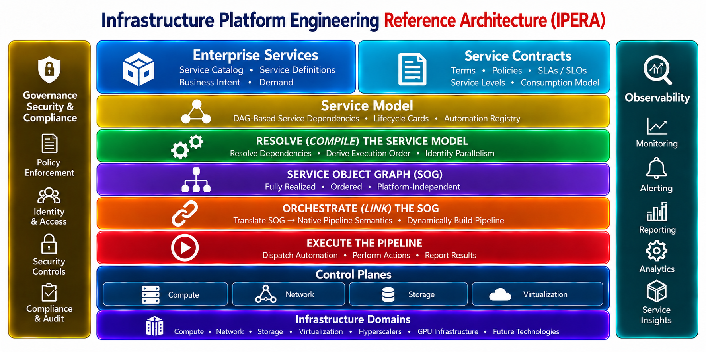

# IPERA Functional Architecture Requirements — Draft v0.3 — Discussion Draft

## 1. Purpose

**OpenIPERA is an open implementation of the Infrastructure Platform Engineering Reference Architecture (IPERA)**, an architectural approach to engineering enterprise infrastructure services as explicit, dependency-aware operational systems.

The idea behind IPERA is straightforward: enterprise infrastructure services should be defined by what they require, how they depend on one another, and what obligations must be satisfied to make them operational—not by the workflows someone happened to write to provision them. IPERA is designed to simplify enterprise infrastructure automation by eliminating the need to manually construct and maintain complex, service-specific workflows and pipelines, making complete service realization derivable from authoritative service knowledge.

Consider Kubernetes Resource Orchestrator (KRO). KRO demonstrates how complex resource requirements can be abstracted behind a declarative interface, allowing the underlying system to resolve and manage the necessary resource relationships. IPERA builds on similar architectural principles but applies them at the enterprise infrastructure service level, where realizing a service may involve multiple technology domains, operational control planes, governance requirements, and automation platforms.

IPERA accomplishes this by separating authoritative service knowledge from the mechanisms used to execute it. Service models describe composition, dependencies, and operational obligations. A Service Model Compiler validates and resolves those models into a request-specific **Service Object Graph (SOG)**, representing what must be accomplished to fully operationalize the requested service. Orchestration and automation platforms then determine how to carry out that realization.

This distinction is fundamental. **OpenIPERA is not another workflow engine or automation framework.** Its purpose is to make enterprise service realization a consequence of an authoritative service model rather than a collection of independently maintained workflows.

This document identifies the functional capabilities required to implement IPERA, establishes the responsibilities and boundaries of those capabilities, and maps them to opinionated tooling choices. These choices are examples of technologies that may fulfill the requirements, not mandatory architectural dependencies. Existing enterprise tooling can participate wherever it satisfies the defined capabilities and contracts.

## IPERA Functional Architecture



The diagram illustrates the functional capabilities and architectural boundaries of IPERA, from the authoritative Service Model DAG (SM-DAG) through compilation, orchestration, and automation execution. Each capability has a distinct responsibility, allowing existing enterprise tooling to participate without assuming ownership of the service model or redefining its semantics. Section 3 identifies these capabilities, their responsibilities, and their architectural boundaries.

---

## Critical Architectural Distinction: Service Model ≠ Execution Model

The **Service Model DAG (SM-DAG)** is authoritative service knowledge, not an orchestration workflow. It describes how services are composed and decomposed into Service Nodes (SNs) and terminal Atomic Nodes (ANs), and which services depend on others. Lifecycle Cards (LCs) and the automation registry supply the associated obligations, governance context, and executable bindings. None of these structures should be confused with a workflow authored for a particular execution engine.

When a service is requested, the **Service Model Compiler**, including its Service Model Validator (SMV), validates the relevant model, resolves its dependency closure, and derives a request-specific **Service Object Graph (SOG)**. The SOG expresses what must be accomplished to operationalize the service: dependencies, obligations, service-completion milestones, ordering constraints, and allowable parallelism. It is a compiled representation of the required realization, **not an executable workflow**.

The **DAG orchestrator** consumes the SOG and translates its semantics into an executable pipeline for its chosen engine. Automation execution capabilities then perform the bound actions against the appropriate control planes and return results and evidence. The orchestrator does not need to interpret the authoritative service model or invent service dependencies; that work belongs to the compiler.

```text
AUTHORITATIVE SERVICE KNOWLEDGE          COMPILED CONTRACT              RUNTIME REALIZATION

Service Model Repository
  ├── Service Model DAG (SM-DAG)
  │     ├── Service Nodes (SNs)
  │     └── Atomic Nodes (ANs)
  ├── Lifecycle Cards (LCs)
  └── Automation Registry
               │
               │ authoritative inputs
               ▼
       Service Model Compiler
         (including SMV)
       Validate • Resolve • Compile
               │
               │ produces
               ▼
       Service Object Graph (SOG) ───────► DAG Orchestrator
       Request-specific obligations       Translate SOG into
       and dependency semantics           engine-native pipeline
                                                 │
                                                 ▼
                                        Automation Execution
                                                 │
                                                 ▼
                                        Control Planes / Services
                                                 │
                                                 ▼
                                        Results / Evidence / Feedback
```

The distinction matters because the service model can evolve independently of any particular orchestration or automation product. A compiled SOG captures the obligations and dependency semantics for a specific request at a particular point in time; the execution pipeline is the engine-specific realization of that compiled contract.

The following requirements apply to every IPERA implementation:

- The Service Model Repository remains authoritative for service composition and dependencies. Neither the compiler nor an orchestration or execution platform may silently redefine them.
- The compiler is responsible for validating the relevant service knowledge and producing the SOG. The orchestrator must not assume those compilation responsibilities.
- The orchestrator consumes the SOG and builds or coordinates an executable pipeline without becoming the authoritative owner of service definitions.
- Workflows in AAP, Airflow, Argo, or another platform must not become the authoritative definition of a service.
- Replacing an orchestration or automation product must not require redefining the SM-DAG or changing the architectural semantics of the SOG.
- The orchestrator's internal pipeline representation and the execution capability's implementation mechanisms remain product-specific choices.

### Architectural Conformance Test

> **If replacing the orchestration platform requires rebuilding the authoritative service model or changing the meaning of the compiled SOG, orchestration-specific concerns have leaked across the architectural boundary. The implementation does not conform to IPERA's separation of responsibilities.**

---

## 2. Service Model Constructs and Properties

The IPERA Service Model describes enterprise infrastructure services through explicit constructs and relationships. The **Service Model DAG (SM-DAG)** consists of Service Nodes (SNs), terminal Atomic Nodes (ANs), and directed structural relationships. Lifecycle Cards (LCs), Service Contracts, and automation registry entries provide associated service knowledge; they are not vertices in the SM-DAG.

**The DAG is fundamental:** an upper-level Service Node depends on subordinate nodes by virtue of the directed graph itself. Structural dependencies are inherent in those edges and are not restated in Lifecycle Cards. Separately, an LC may declare dependencies on other modeled services outside its node's structural decomposition. The Service Model Compiler resolves both forms of dependency when deriving the Service Object Graph (SOG). Neither form of dependency requires a referenced service to be independently callable.

```text
                         Create VM (SN) -------- Lifecycle Card (LC)
                         /            \                  |
                        v              v                 +-- Service Dependencies
              Provision VM (SN)    Configure OS (SN)     |    +-- Allocate IP (SN)
                  /      \                |              |    +-- Configure DNS (SN)
                 v        v               v              |    +-- Storage (SN)
           Create VM   Attach Disk    Configure OS       |    +-- Network (SN)
              (AN)        (AN)           (AN)            |
                                                         +-- Operational Obligations
                                                              +-- Observability
                                                              +-- Health Verification
                                                              +-- Governance / Approvals
```

### 2.1 Service Model Constructs

| Construct | Definition | Architectural characteristics |
|---|---|---|
| **Service Model DAG (SM-DAG)** | Directed acyclic graph of service composition and structural dependencies. | Authoritative service knowledge, not an executable workflow or pipeline. |
| **Service Node (SN)** | A service construct that may decompose into subordinate SNs or ANs. | May be independently callable or participate only as part of another service. |
| **Atomic Node (AN)** | Terminal service construct representing an obligation fulfilled through automation. | Last service construct before automation; has no subordinate nodes or independent service dependencies. |
| **Lifecycle Card (LC)** | Associated metadata describing a node's obligations, governance properties, and additional service requirements. | Not a graph vertex; declares requirements but does not adjudicate or enforce authorization. |
| **Service Contract** | Machine-consumable definition of how an independently callable SN can be requested. | Defines consumption semantics, distinct from catalog publication and authorization. |
| **Automation Registry Entry** | Maps a governed automation identity to its current implementation. | Implementation remains external to the Service Model and is not embedded in an AN. |

### 2.2 Service Model Properties and Constraints

| Property | Applies to | Requirement |
|---|---|---|
| **Persistent identity** | SN, AN | A stable identity distinguishes the logical construct from its name, placement, or implementation. |
| **Node type** | SN, AN | Distinguishes decomposable SNs from terminal ANs. |
| **Structural dependencies** | SM-DAG, SN | Directed parent-to-subordinate edges inherently express the parent's dependencies. This is why the Service Model is a DAG. |
| **LC-declared service dependencies** | LC | An LC may reference additional required services elsewhere in the model. These references are distinct from structural decomposition and do not make referenced services callable. |
| **Terminality** | AN | An AN has no children or independently declared service dependencies; its associated LC identifies its automation binding. |
| **Lifecycle association** | SN, AN, LC | Every modeled node has exactly one associated LC, and each LC belongs to one node. |
| **Callability** | SN | Explicit property determining whether a service can be requested independently; participation in the graph does not imply callability. |
| **Service Contract** | Callable SN | Required for independent consumption; specifies inputs, outputs/status, parameters and constraints, contract version, and invocation/interface binding. |
| **Governance properties** | LC | May declare approval, authorization, policy, and observability requirements without assigning enforcement to IPERA. |
| **Automation binding** | AN-associated LC | References automation by governed identity; the registry resolves its current implementation. Executable code is not embedded in an AN. |
| **Object evolution** | SN, AN, LC, Service Contract | Definitions can evolve while preserving logical identity. Detailed versioning and compatibility requirements remain to be defined. |
| **Model integrity** | SM-DAG and associated knowledge | Structural graph must be acyclic; references and node/LC associations must resolve; terminal paths must end in ANs with valid automation bindings. |

### 2.3 Service Consumption and Authority

**Not every Service Node is independently callable.** A non-Atomic Service Node intended for independent consumption **MUST** define a machine-consumable Service Contract. Other Service Nodes can participate in decomposition or satisfy LC-declared dependencies without exposing a callable interface. A request for a callable service through IPERA still requires the compiler to derive its complete modeled obligations; callability does not permit substituting a manually assembled workflow for model resolution.

Callability, catalog publication, and authorization are distinct. The Service Model describes whether a service is callable and defines its contract. An enterprise catalog may publish that capability through a governed interface, including a catalog intended only for IT Operations. Enterprise catalog, identity, and governance systems control exposure and determine who may invoke it. Lifecycle Cards may declare authorization requirements, but **IPERA does not adjudicate authorization**.

A capability becomes a Service Catalog offering when it is exposed through a governed catalog interface. Publication does not alter its structural or LC-declared dependencies.

---

## 3. Required Tooling Capabilities

The following table identifies the tooling capabilities required to implement IPERA. **Functional Responsibilities** define what each capability must accomplish; **Explicit Non-Responsibilities** establish its architectural boundary. A product may provide multiple capabilities, but doing so does not transfer authority between them. APIs, adapters, validation modes, and deployment topology are features or implementation details of these capabilities, not additional tooling categories.

**Required assessment guidance.** This table is the baseline for identifying existing tooling, qualifying its architectural fit, and recording capability gaps. A product's presence or advertised features do **not** establish that it satisfies a capability. Assess each candidate against both its **Functional Responsibilities** and **Explicit Non-Responsibilities**, using demonstrated behavior or verifiable integration evidence. Record **capability fit** separately from **implementation readiness**: a suitable product may still require configuration or integration before it can fulfill the role. Identify gaps in required capabilities first; do not presume that every gap requires a new product, since configuration, integration, extension, or development may close it. Where evidence is insufficient, mark the capability **not yet assessed** rather than satisfied.

| Tooling Capability | Functional Responsibilities | Explicit Non-Responsibilities | Opinionated Solutions |
|---|---|---|---|
| **Service Catalog** | • Publish governed service offerings.<br>• Expose applicable Service Contracts.<br>• Collect service-request parameters.<br>• Submit requests against a defined service-model entry point. | Does not author the service dependency model, compile SOGs, or construct execution pipelines. | ServiceNow Service Catalog; Backstage |
| **Service Model Repository** | • Maintain authoritative SM-DAGs and node definitions.<br>• Maintain associated Lifecycle Cards.<br>• Maintain declared service dependencies and Service Contracts.<br>• Maintain governed automation binding references.<br>• Preserve stable model identities and revision information. | Does not compile a request-specific SOG, execute automation, or become the orchestration engine. | ServiceNow (subject to model fit); demonstration etcd-backed repository |
| **Version Control System (VCS)** | • Version automation and declarative implementation artifacts.<br>• Preserve artifact provenance and change history.<br>• Support review and controlled changes to artifacts.<br>• Provide resolvable artifact identities. | Does not define service composition, derive dependency order, or determine when automation executes. | GitHub; GitLab; Bitbucket |
| **Service Model Compiler (including SMV)** | • Validate service-model structural and semantic integrity.<br>• Validate Lifecycle Card associations and references.<br>• Resolve applicable service dependency closure.<br>• Resolve applicable Lifecycle Card operational obligations.<br>• Derive the deterministic, request-specific Service Object Graph (SOG).<br>• Identify invalid references and unmet realization requirements distinctly.<br>• Produce diagnostics and preserve compilation provenance. | Does not author the authoritative service model, construct engine-native workflows, execute automation, or reconcile observed infrastructure state. | OpenIPERA |
| **CI/CD Platform** | • Validate automation and platform implementation artifacts.<br>• Test implementation artifacts.<br>• Package and publish qualified artifacts.<br>• Promote approved implementations.<br>• Enforce engineering quality gates. | Does not own the service model, compile request-specific SOGs, or serve as the runtime service orchestrator. | GitHub Actions; GitLab CI/CD; Jenkins; Tekton |
| **DAG Orchestrator** | • Consume the compiled SOG.<br>• Construct an engine-native executable pipeline.<br>• Preserve compiled dependency and obligation semantics.<br>• Coordinate execution progress, failures, and outcomes.<br>• Report realization execution status and results. | Does not independently rediscover or redefine service composition, alter the SOG's dependency semantics, or own domain automation. | Apache Airflow; Argo; Spacelift (integration fit to be verified) |
| **Automation Execution Capability** | • Accept resolved automation bindings and execution context.<br>• Invoke automation implementations against target control planes.<br>• Return execution status and outputs.<br>• Produce execution evidence. | Does not determine service composition, compile SOGs, or independently construct the end-to-end realization plan. | Ansible/AAP; Terraform/OpenTofu; Spacelift execution facilities; Python; PowerShell |
| **State / Evidence Capability** | • Record service-realization outcomes.<br>• Preserve execution evidence and realization provenance.<br>• Correlate evidence with requests, services, and atomic actions.<br>• Support verification of completed realization obligations. | Does not define the authoritative service model or independently determine required service dependencies. | Existing enterprise state and evidence platforms |
| **Operational Feedback / Observability** | • Collect operational telemetry.<br>• Observe service health and availability.<br>• Detect operational events and state changes.<br>• Identify deviations from expected operational conditions.<br>• Supply evidence for ongoing lifecycle assurance. | Does not author the SM-DAG, compile SOGs, or independently define service composition. | Existing enterprise monitoring, telemetry, and AIOps platforms |

**Compiler / Linker / Loader / Runtime analogy.** OpenIPERA's Service Model Compiler produces the Service Object Graph (SOG), analogous to a compiler producing object code. The DAG Orchestrator acts as a linker, transforming the SOG into an executable realization pipeline. CI/CD is analogous to a loader, preparing and deploying qualified automation implementations for execution. The Automation Execution Capability provides the runtime that invokes those implementations against target infrastructure and control planes. As with traditional computing, these are distinct responsibilities even when a single product implements several of them. The analogy describes architectural roles rather than a literal, mandatory execution sequence.

Governance, security, approvals, control planes, and infrastructure domains remain cross-cutting architectural obligations and integration boundaries, as shown in the functional architecture diagram. Kubernetes packaging, northbound APIs, SOM adapters, and reference deployment choices are addressed in implementation requirements rather than treated as separate tooling capabilities.

### 3.1 Compiler Operations and Validation Boundaries

| Operation | Scope parameter | Resolution parameter | Required behavior |
|---|---|---|---|
| **Validate** | SM-DAG module | **local** | Check module-internal structural and semantic integrity; identify external references without requiring their full resolution |
| **Validate** | SM-DAG module | **resolved** | Check module integrity and the applicable dependency closure against the authoritative SOM |
| **Validate** | Service request | **resolved** | Validate the complete service-request dependency closure and report whether required modeled capabilities and bindings are satisfiable |
| **Compile** | Service request | **resolved (mandatory)** | Validate the same immutable model snapshot used for dependency resolution, then emit the SOG or a structured failure/partial-realization diagnostic; never silently repair invalid input |

The **SMV is a named, independently callable capability within the compiler**, not a peer microservice. Validation can stop before SOG generation. The compiler must distinguish **invalid model references** from **validly modeled but unavailable or unimplemented capabilities**, reporting the latter as realization gaps rather than silently treating them as implemented.

A module's **local** validation is not evidence that a complete service request can be realized. Every compilation uses **resolved** validation over the request's applicable dependency closure, with the requested boundary, examined closure, authoritative revision, and diagnostics included in its result.

`*` **Conditional fit:** Named products are examples, not declarations of conformance. Actual suitability depends on supported interfaces, integration semantics, and deployment configuration.

---

## 4. Separation of Service Model and Automation

```text
                 SERVICE DOMAIN

                Service Deck
                     │
              Lifecycle Card
                     │
                Atomic Node
                     │
             automation binding
                     │
─────────────────────┼────────────────────
                     │
              AUTOMATION DOMAIN
                     │
                     ▼
          Version-Controlled Artifact
                     │
              Execution Contract
                     │
                     ▼
            Execution Capability
                     │
        API / CLI / SDK / Provider
                     │
                     ▼
            Target / Control Plane
```

The AN crosses the boundary **by reference**, not by containing automation.

---

## 5. Service Invocation Model

The same Service Dependency DAG may support multiple entry points.

For example:

```text
                  General Purpose Compute
                    [Callable Contract]
                           │
              ┌────────────┼────────────┐
              ▼            ▼            ▼
           Compute       Network     Identity
        [Callable]      [Callable]    [Internal]
              │
              ▼
        Lifecycle Cards
              │
              ▼
         Atomic Nodes
              │
              ▼
          Automation
```

A general consumer may request **General Purpose Compute** using a high-level contract.

An infrastructure team may independently request **Compute** using a lower-level contract containing CPU, memory, operating system, network, location and other domain-specific parameters.

Both requests enter the **same service model at different abstraction levels**.

A node need not be callable merely because it participates in the DAG.

---

## 6. Architectural Invariants

1. **The Service Dependency DAG exists independently of a service request.**

2. **The orchestrator navigates the Service Dependency DAG; it does not create it.**

3. **The execution pipeline is dynamically derived from the service model and is not itself the authoritative service definition.**

4. **The Atomic Node is the final service-model construct before automation.**

5. **Atomic Nodes bind to externally versioned automation artifacts; they do not contain executable automation.**

6. **A callable non-AN service node exposes a versioned Service Contract appropriate to its level of abstraction.**

7. **Not every node in the Service Dependency DAG must be callable.**

8. **Any capability that is invoked programmatically must provide an appropriate machine-consumable interface.**

9. **Execution mechanisms execute modeled intent; they do not determine service composition.**

10. **IPERA defines functional contracts, not mandatory products.**

11. **The Service Model Repository owns the authoritative Service Dependency DAG and MUST remain authoritative regardless of orchestration technology. Replacing the orchestrator MUST NOT require redefining the logical service model.**

12. **The orchestrator MUST consume and traverse the persistent service model and dynamically construct dependency-aware execution. Native DAG authoring is not an IPERA requirement; the internal representation of the execution plan is an implementation detail.**

---

## 7. Open Architectural Question: State / Evidence / Observability / Reconciliation

This area remains open for architecture review with Rob. The KRO comparison highlights the need for further consideration of:

```text
SPEC
What was requested?

STATUS
What currently exists?

READINESS
Does observed state satisfy modeled intent?

RECONCILIATION
If not, what should happen?
```

> **Open architectural question: determine whether desired-state evaluation and reconciliation constitute a separate IPERA functional component or responsibilities distributed among the Service Model, Orchestrator, and Operational Feedback capabilities.**

