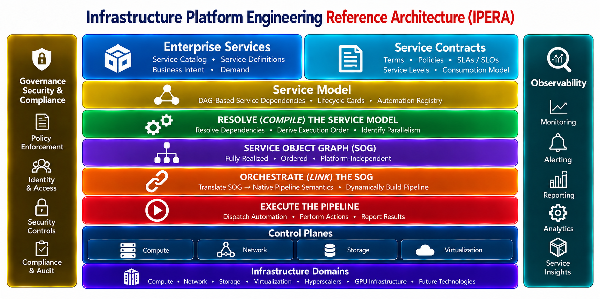

# IPERA Functional Architecture Requirements — Draft v0.3 — Discussion Draft

## 1. Purpose

IPERA defines an architectural model for realizing and operating enterprise services through declarative service models, dependency-aware orchestration, and reusable automation.

IPERA specifies **functional capabilities and contracts rather than mandatory products**. An implementation may use any technology that satisfies the functional requirements and architectural boundaries defined here.

Opinionated solutions identify technologies believed capable of satisfying a particular IPERA role. They are implementation options, not architectural dependencies.

IPERA intentionally applies established architectural patterns—including declarative intent, abstraction through contracts, dependency graphs, reconciliation, desired versus observed state, and separation of intent from implementation—at the enterprise-service level.

Kubernetes and Kubernetes Resource Orchestrator (KRO) provide useful contemporary examples of these patterns at the resource-composition level. IPERA applies analogous patterns at a broader service abstraction.

## IPERA Functional Architecture



The diagram illustrates the functional layers and boundaries of IPERA. Component responsibilities and interfaces are specified in [Section 3: Functional Components](#3-functional-components). The image title will be updated separately; the existing asset is retained until that replacement is available.

---

## Critical Architectural Distinction: Service Model ≠ Execution Model

> **The IPERA Service Dependency DAG is part of the authoritative Service Model. It is NOT an orchestration workflow and MUST NOT be owned by an execution or orchestration platform merely because that platform represents workflows as DAGs.**

The Service Dependency DAG describes **what a service is**: its decomposition, relationships, dependencies, lifecycle constructs, and bindings.

The **Dependency-Aware, Model-Driven Orchestrator** consumes and navigates this persistent model for a particular service request. Through graph consumption and traversal, it resolves dependencies and dynamically constructs a dependency-aware **runtime execution plan / pipeline**.

```text
AUTHORITATIVE SERVICE MODEL                  RUNTIME EXECUTION

Service Model Repository
          │
          │ owns
          ▼
Service Dependency DAG ────────────────────► Orchestrator
                     consumed / traversed by     │
                                                 │ dynamically constructs
                                                 ▼
                                       Execution Plan / Pipeline
                                                 │
                                                 ▼
                                        Execution Capabilities
```

> **The Service Dependency DAG is persistent service knowledge. The execution pipeline is an ephemeral realization of that knowledge.**

The following requirements apply to every IPERA implementation:

- The orchestrator MUST NOT become the authoritative repository for service dependencies.
- A workflow defined in AAP, Airflow, or another orchestration product MUST NOT become the authoritative definition of the service.
- The Service Model Repository MUST remain authoritative regardless of orchestration technology selected.
- Replacing the orchestrator MUST NOT require redefining the logical service model.
- An IPERA orchestrator is required to be **dependency-aware and model-driven**; it is not required to provide a particular native DAG-authoring mechanism.
- How an orchestrator internally represents the resulting execution plan is an implementation detail.

### Architectural Conformance Test

> **If replacing the orchestration platform requires rebuilding the authoritative definition of the service and its dependencies, service-model responsibility has leaked into the orchestration layer and the implementation does not conform to this IPERA separation of responsibilities.**

---

## 2. Core Architectural Principles

### 2.1 Service Dependency DAG

The decomposed enterprise service model forms a persistent **Service Dependency DAG**.

The DAG exists independently of any individual service request or execution pipeline.

The DAG represents:

- service decomposition;
- dependencies between services;
- Lifecycle Cards associated with services;
- Atomic Nodes associated with lifecycle actions;
- callable service contracts where applicable;
- bindings between Atomic Nodes and automation artifacts.

The Service Dependency DAG is **not an execution workflow**.

---

### 2.2 Dynamic Execution

When a service is requested, the orchestrator:

```text
Service Request
      │
      ▼
Service Dependency DAG
      │
      │ navigate
      ▼
Relevant Services / LCs / ANs
      │
      │ resolve
      ▼
Automation Bindings
      │
      ▼
Dynamic Execution Pipeline
      │
      ▼
Execution
```

The orchestrator **navigates an existing DAG**. It does not construct the Service Dependency DAG.

The resulting execution pipeline is an ephemeral realization of a particular request and must not become the authoritative representation of the service.

---

### 2.3 Service Contracts

Not every node in the Service Dependency DAG must be independently callable.

A non-Atomic service node that is intended to be independently consumed MUST define a machine-consumable **Service Contract**.

The contract defines, at minimum:

- input specification/schema;
- required and optional parameters;
- parameter constraints/defaults where appropriate;
- outputs/status;
- contract version;
- invocation/interface binding.

Different abstraction levels may therefore expose different contracts.

For example:

```text
General Purpose Compute
    │
    │ Consumer-facing contract
    │ "Give me compute suitable for this workload"
    ▼
Compute Service
    │
    │ Infrastructure-facing contract
    │ "Give me a VM with these specifications"
    ▼
Lifecycle Cards
    │
    ▼
Atomic Nodes
```

A caller entering the graph at `Compute Service` may therefore supply implementation-specific parameters that a consumer entering at `General Purpose Compute` neither knows nor needs to know.

---

### 2.4 Atomic Nodes

An **Atomic Node (AN)** is the lowest-level service construct within IPERA.

> **The Atomic Node is the last service construct before automation begins.**

An AN represents a discrete lifecycle action and binds that action to an external, version-controlled automation artifact.

An Atomic Node:

- describes the modeled action;
- contains the binding/reference necessary to locate its automation implementation;
- does **not** contain executable automation.

Conceptually:

```text
Lifecycle Card
      │
      ▼
Atomic Node
      │
      │ automation binding
      ▼
Versioned Artifact
      │
      ▼
Executable Command / Automation
      │
      ▼
Execution Capability
```

The automation artifact may contain something as simple as a command or as complex as Terraform/OpenTofu, Ansible content, Python, PowerShell, or domain-specific automation.

---

### 2.5 Programmatic Interfaces

Any IPERA component or service capability that must be invoked by another component MUST expose an appropriate machine-consumable interface.

Such interfaces may include:

- REST APIs;
- GraphQL;
- event/message interfaces;
- SDKs;
- CLIs;
- providers/plugins;
- other deterministic programmatic mechanisms.

Participation in the Service Dependency DAG does **not** itself require a service node to expose an API.

Callable service nodes must expose a Service Contract and invocation binding.

Atomic Nodes do not themselves expose service APIs. They bind modeled lifecycle actions to automation artifacts that are executed through an appropriate execution capability.

---

## 3. Required Tooling Capabilities

The following table identifies the tooling capabilities required to implement IPERA. **Functional Responsibilities** define what each capability must accomplish; **Explicit Non-Responsibilities** establish its architectural boundary. A product may provide multiple capabilities, but doing so does not transfer authority between them. APIs, adapters, validation modes, and deployment topology are features or implementation details of these capabilities, not additional tooling categories.

| Tooling Capability | Functional Responsibilities | Explicit Non-Responsibilities | Opinionated Solutions |
|---|---|---|---|
| **Service Catalog** | Expose governed service offerings and contracts; collect request inputs; submit requests against a defined service-model entry point. | Does not author the service dependency model, compile SOGs, or construct execution pipelines. | ServiceNow Service Catalog; Backstage |
| **Service Model Repository** | Maintain and expose the authoritative SM-DAG, Service Nodes, Atomic Nodes, Lifecycle Cards, dependencies, contracts, and automation bindings with stable identity and revision information. | Does not compile a request-specific SOG, execute automation, or become the orchestration engine. | ServiceNow (subject to model fit); demonstration etcd-backed repository |
| **Version Control System (VCS)** | Version automation and declarative artifacts; preserve provenance, review history, and resolvable artifact identities used by automation bindings. | Does not define service composition, derive dependency order, or determine when automation executes. | GitHub; GitLab; Bitbucket |
| **CI/CD Platform** | Validate, test, package, and promote automation artifacts and platform software under engineering quality gates. | Does not own the service model, compile request-specific SOGs, or serve as the runtime service orchestrator. | GitHub Actions; GitLab CI/CD; Jenkins; Tekton |
| **Service Model Compiler (including SMV)** | Validate bounded service models; resolve the authoritative dependency closure; compile a deterministic, request-specific **Service Object Graph (SOG)** with diagnostics and provenance. | Does not author the authoritative service model, construct engine-native workflows, execute automation, or reconcile observed infrastructure state. | OpenIPERA |
| **DAG Orchestrator** | Consume a compiled SOG; translate its dependency and obligation semantics into a native executable pipeline; coordinate execution and report outcomes. | Does not independently rediscover or redefine service composition, alter the SOG's dependency semantics, or own domain automation. | Apache Airflow; Argo; Spacelift (integration fit to be verified) |
| **Automation Execution Capability** | Execute governed automation bindings through target control planes; accept execution context and return status, outputs, and evidence. | Does not determine service composition, compile SOGs, or independently construct the end-to-end realization plan. | Ansible/AAP; Terraform/OpenTofu; Spacelift execution facilities; Python; PowerShell |
| **State / Evidence Capability** | Record execution results, provenance, and realization evidence; correlate them with requests, services, and atomic actions. | Does not define the authoritative service model or independently determine required service dependencies. | Existing enterprise state and evidence platforms |
| **Operational Feedback / Observability** | Observe service health, events, drift, and operational outcomes; supply evidence for lifecycle decisions and assurance. | Does not author the SM-DAG, compile SOGs, or independently define service composition. | Existing enterprise monitoring, telemetry, and AIOps platforms |

Governance, security, approvals, control planes, and infrastructure domains remain cross-cutting architectural obligations and integration boundaries, as shown in the functional architecture diagram. Kubernetes packaging, northbound APIs, SOM adapters, and reference deployment choices are addressed in implementation requirements rather than treated as separate tooling capabilities.

### 3.1 Compiler Operations and Validation Boundaries

| Operation | Scope parameter | Resolution parameter | Required behavior |
|---|---|---|---|
| **Validate** | SM-DAG module | **local** | Check module-internal structural and semantic integrity; identify external references without requiring their full resolution |
| **Validate** | SM-DAG module | **resolved** | Check module integrity and the applicable dependency closure against the authoritative SOM |
| **Validate** | Service request | **resolved** | Validate the complete service-request dependency closure and report whether required modeled capabilities and bindings are satisfiable |
| **Compile** | Service request | **resolved (mandatory)** | Validate the same immutable model snapshot used for dependency resolution, then emit the SOG or a structured failure/partial-realization diagnostic; never silently repair invalid input |

The **SMV is a named, independently callable capability within the compiler**, not a peer microservice. Validation can stop before SOG generation. The compiler must distinguish **invalid model references** from **validly modeled but unavailable or unimplemented capabilities**, reporting the latter as realization gaps rather than silently treating them as implemented.

A module's **local** validation is not evidence that a complete service request can be realized. Every compilation uses **resolved** validation over the request's applicable dependency closure, with the requested boundary, examined closure, authoritative revision, and diagnostics included in its result.

`*` **Conditional fit:** Named products are examples, not declarations of conformance. Actual suitability depends on supported interfaces, integration semantics, and deployment configuration.

---

## 4. Separation of Service Model and Automation

```text
                 SERVICE DOMAIN

                Service Deck
                     │
              Lifecycle Card
                     │
                Atomic Node
                     │
             automation binding
                     │
─────────────────────┼────────────────────
                     │
              AUTOMATION DOMAIN
                     │
                     ▼
          Version-Controlled Artifact
                     │
              Execution Contract
                     │
                     ▼
            Execution Capability
                     │
        API / CLI / SDK / Provider
                     │
                     ▼
            Target / Control Plane
```

The AN crosses the boundary **by reference**, not by containing automation.

---

## 5. Service Invocation Model

The same Service Dependency DAG may support multiple entry points.

For example:

```text
                  General Purpose Compute
                    [Callable Contract]
                           │
              ┌────────────┼────────────┐
              ▼            ▼            ▼
           Compute       Network     Identity
        [Callable]      [Callable]    [Internal]
              │
              ▼
        Lifecycle Cards
              │
              ▼
         Atomic Nodes
              │
              ▼
          Automation
```

A general consumer may request **General Purpose Compute** using a high-level contract.

An infrastructure team may independently request **Compute** using a lower-level contract containing CPU, memory, operating system, network, location and other domain-specific parameters.

Both requests enter the **same service model at different abstraction levels**.

A node need not be callable merely because it participates in the DAG.

---

## 6. Architectural Invariants

1. **The Service Dependency DAG exists independently of a service request.**

2. **The orchestrator navigates the Service Dependency DAG; it does not create it.**

3. **The execution pipeline is dynamically derived from the service model and is not itself the authoritative service definition.**

4. **The Atomic Node is the final service-model construct before automation.**

5. **Atomic Nodes bind to externally versioned automation artifacts; they do not contain executable automation.**

6. **A callable non-AN service node exposes a versioned Service Contract appropriate to its level of abstraction.**

7. **Not every node in the Service Dependency DAG must be callable.**

8. **Any capability that is invoked programmatically must provide an appropriate machine-consumable interface.**

9. **Execution mechanisms execute modeled intent; they do not determine service composition.**

10. **IPERA defines functional contracts, not mandatory products.**

11. **The Service Model Repository owns the authoritative Service Dependency DAG and MUST remain authoritative regardless of orchestration technology. Replacing the orchestrator MUST NOT require redefining the logical service model.**

12. **The orchestrator MUST consume and traverse the persistent service model and dynamically construct dependency-aware execution. Native DAG authoring is not an IPERA requirement; the internal representation of the execution plan is an implementation detail.**

---

## 7. Open Architectural Question: State / Evidence / Observability / Reconciliation

This area remains open for architecture review with Rob. The KRO comparison highlights the need for further consideration of:

```text
SPEC
What was requested?

STATUS
What currently exists?

READINESS
Does observed state satisfy modeled intent?

RECONCILIATION
If not, what should happen?
```

> **Open architectural question: determine whether desired-state evaluation and reconciliation constitute a separate IPERA functional component or responsibilities distributed among the Service Model, Orchestrator, and Operational Feedback capabilities.**

