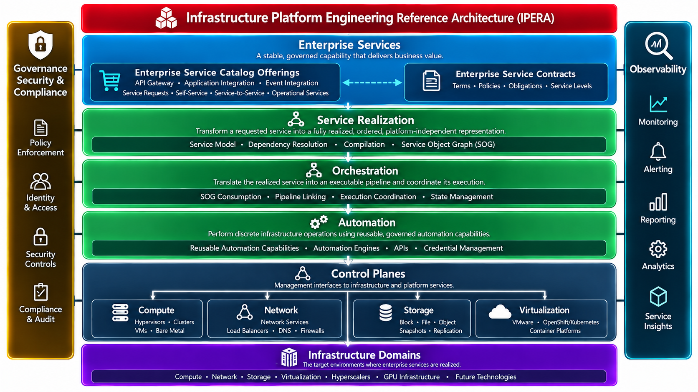
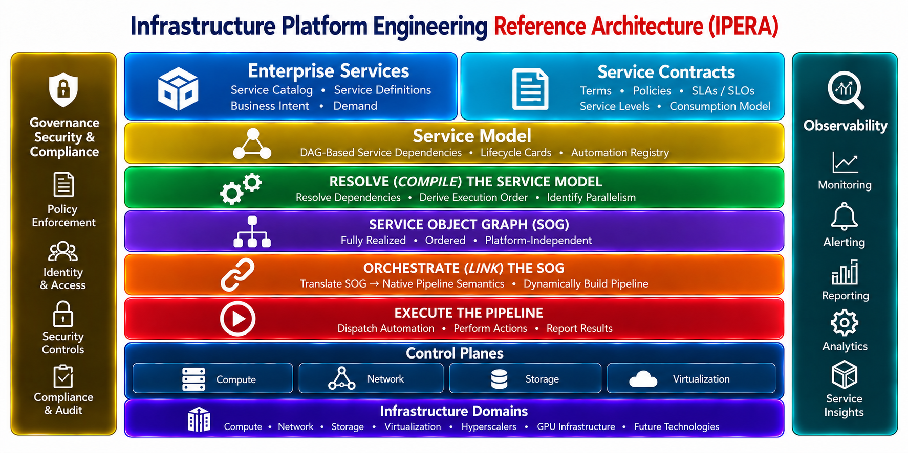

# Architecture

## From authoritative knowledge to executable realization

OpenIPERA separates the **description of a service** from the **mechanisms that realize it**.

## Two complementary architectural views

  <article class="architecture-panel">
    <h3>Reference Architecture — What</h3>
    
    
The architectural capabilities, responsibilities, and relationships that define IPERA.

    
<a href="{{ '/architecture/reference-architecture/' | relative_url }}">Explore the Reference Architecture</a>

  </article>
  <article class="architecture-panel">
    <h3>Functional Architecture — How</h3>
    
    
The execution layers and tooling abstractions through which architectural responsibilities are realized.

    
<a href="{{ '/architecture/execution-layers/' | relative_url }}">Explore the Functional Architecture</a>

  </article>

These are **complementary views, not two versions of the same diagram**. The reference architecture defines the architectural model; the functional architecture describes realization abstractions without making any specific tooling the architecture itself.

### The Service Model

The **Service Model DAG (SM-DAG)** represents service decomposition through **Service Nodes (SNs)** and terminal **Atomic Nodes (ANs)**. Each node has a companion **Lifecycle Card (LC)** expressing realization knowledge, such as service dependencies and obligations. An Atomic Node's LC references a stable automation capability identity; it does not contain executable automation.

A service dependency is not necessarily a decomposition relationship or an execution-order instruction. Dependencies may cross service domains, and some obligations are fulfilled by external processes rather than directly executable automation.

### Validate, then compile

The **Service Model Validator (SMV)** independently evaluates model integrity, references, dependencies, cycles, and automation-binding resolvability. It reports findings; it does not silently repair authoritative knowledge or authorize a service.

The **Compiler** combines applicable validated service knowledge with a particular request context to produce a **Service Object Graph (SOG)**. The Compiler must establish that its actual inputs correspond to the referenced SMV validation result and reject inconsistent inputs.

The SOG is a derived, request-specific representation of service obligations and their dependencies. **It is not an executable workflow or a replacement for the authoritative Service Model.**

### Link and execute

An **Orchestrator** consumes the SOG, resolves stable automation capability identities to identifiable implementation revisions through the Automation Registry, and constructs executable workflows. Execution capabilities perform the selected operations and produce outcomes and evidence.

OpenIPERA does not mandate an orchestration engine, automation product, organizational team structure, or persistent storage of complete SOGs.

### Provenance and observability by design

OpenIPERA requires internal hierarchical component identities and revisions, uniquely identifiable SMV validation results, and compilation consistency checks.

Every compiled SOG carries a **provenance manifest** identifying the request context, validation reference, and exact service-model components and revisions consumed. OpenIPERA components emit structured, correlated observability events; mandatory compilation provenance events must be durably accepted internally before SOG publication succeeds.

This **native OpenIPERA instrumentation** is distinct from the broader **IPERA Observability** pillar, which concerns operational assurance and evidence. Similarly, **IPERA Governance** establishes organizational policy and authorization; SMV validation alone is not governance approval.

## Architectural boundaries

| Responsibility | Architectural role |
|---|---|
| Describe services and dependencies | SM-DAG and Lifecycle Cards |
| Validate authoritative knowledge | SMV |
| Derive request-specific obligations | Compiler and SOG |
| Construct and coordinate workflows | Orchestrator |
| Perform operations | Execution capabilities |
| Govern, observe, and accept operational services | Organizational systems and broader IPERA pillars |

For detailed semantics, see [Document 05 — Service Model Compilation Architecture](https://github.com/openipera/openipera-architecture/blob/main/documentation/05_IPERA_SERVICE_MODEL_COMPILATION_ARCHITECTURE.md) and [Document 06 — Deterministic Service Realization](https://github.com/openipera/openipera-architecture/blob/main/documentation/06_IPERA_DETERMINISTIC_SERVICE_REALIZATION.md).
