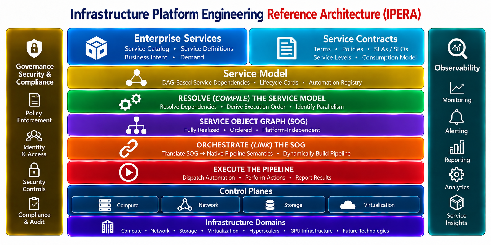

# IPERA Functional Architecture

**Execution layers and tooling abstractions — how the architectural responsibilities are realized.**

This view illustrates the functional layering through which orchestration, execution platforms, and atomic automation capabilities can satisfy the obligations expressed by the service model. It is distinct from the IPERA Reference Architecture: tooling abstractions describe implementation boundaries, not the reference architecture itself.

[Open the full-resolution Functional Architecture diagram in your browser](https://raw.githubusercontent.com/openipera/openipera-architecture/main/images/ipe-model.png)

Compare this view with the [IPERA Reference Architecture]({{ '/architecture/reference-architecture/' | relative_url }}), which defines the architectural capabilities and their relationships independently of implementation tooling.

[Back to Architecture]({{ '/architecture.html' | relative_url }})
