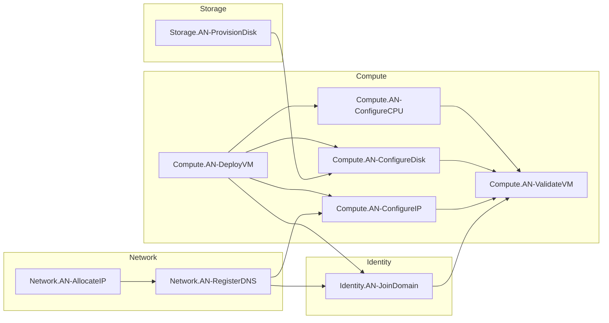

# Derived Execution DAG

## Request

Run ID: `93c80ebc68fd462c9a25a343582ab271`

```json
{"entry_point":"Compute.AN-ValidateVM"}
```

The entry point selects an AN dependency closure; it does not define Service Node semantics.

## Model Snapshot

Source: `http://model:8000/service-model.json`

Content version (SHA-256 of exact source bytes): `87f428a1ba6cc40da5e71dcd224fd9f5c4f35c65919d9a88addf04422d6e56fb`

Exact source bytes: `93c80ebc68fd462c9a25a343582ab271-model.json` (when fetched).

```json
{
  "nodes": [
    {"service": "Compute", "node": "AN-DeployVM", "dependencies": []},
    {"service": "Compute", "node": "AN-ConfigureCPU", "dependencies": ["Compute.AN-DeployVM"]},
    {"service": "Storage", "node": "AN-ProvisionDisk", "dependencies": []},
    {"service": "Compute", "node": "AN-ConfigureDisk", "dependencies": ["Compute.AN-DeployVM", "Storage.AN-ProvisionDisk"]},
    {"service": "Network", "node": "AN-AllocateIP", "dependencies": []},
    {"service": "Network", "node": "AN-RegisterDNS", "dependencies": ["Network.AN-AllocateIP"]},
    {"service": "Compute", "node": "AN-ConfigureIP", "dependencies": ["Compute.AN-DeployVM", "Network.AN-RegisterDNS"]},
    {"service": "Identity", "node": "AN-JoinDomain", "dependencies": ["Compute.AN-DeployVM", "Network.AN-RegisterDNS"]},
    {"service": "Compute", "node": "AN-ValidateVM", "dependencies": ["Compute.AN-ConfigureCPU", "Compute.AN-ConfigureDisk", "Compute.AN-ConfigureIP", "Identity.AN-JoinDomain"]}
  ]
}

```

## Resolved Nodes

- `Compute.AN-ConfigureCPU`
- `Compute.AN-ConfigureDisk`
- `Compute.AN-ConfigureIP`
- `Compute.AN-DeployVM`
- `Compute.AN-ValidateVM`
- `Identity.AN-JoinDomain`
- `Network.AN-AllocateIP`
- `Network.AN-RegisterDNS`
- `Storage.AN-ProvisionDisk`

## Dependency Edges

`A -> B` means **A must complete before B may execute.**

```text
Compute.AN-ConfigureCPU -> Compute.AN-ValidateVM
Compute.AN-ConfigureDisk -> Compute.AN-ValidateVM
Compute.AN-ConfigureIP -> Compute.AN-ValidateVM
Compute.AN-DeployVM -> Compute.AN-ConfigureCPU
Compute.AN-DeployVM -> Compute.AN-ConfigureDisk
Compute.AN-DeployVM -> Compute.AN-ConfigureIP
Compute.AN-DeployVM -> Identity.AN-JoinDomain
Identity.AN-JoinDomain -> Compute.AN-ValidateVM
Network.AN-AllocateIP -> Network.AN-RegisterDNS
Network.AN-RegisterDNS -> Compute.AN-ConfigureIP
Network.AN-RegisterDNS -> Identity.AN-JoinDomain
Storage.AN-ProvisionDisk -> Compute.AN-ConfigureDisk
```

## Derived Execution Layers

Nodes in a layer may execute concurrently. Layers are derived, not model input.

```text
Layer 0
  Compute.AN-DeployVM
  Network.AN-AllocateIP
  Storage.AN-ProvisionDisk

Layer 1
  Compute.AN-ConfigureCPU
  Compute.AN-ConfigureDisk
  Network.AN-RegisterDNS

Layer 2
  Compute.AN-ConfigureIP
  Identity.AN-JoinDomain

Layer 3
  Compute.AN-ValidateVM
```

## Visual Execution DAG



## Resolution Result

- Derived graph valid: yes
- All dependencies resolved: yes
- Cycle detected: no
- Execution completed successfully: yes


## Execution Results

```json
[
  {
    "run_id": "93c80ebc68fd462c9a25a343582ab271",
    "sequence": 7,
    "time_ns": 1790307503964787720,
    "event": "action_finished",
    "node": "Network.AN-AllocateIP",
    "returncode": 0,
    "stdout": "{\"action\": \"Network.AN-AllocateIP\", \"result\": \"ok\"}\n",
    "stderr": "",
    "artifact_sha256": "b999ac0052b75baf78bcf0b5c594dd76b59d036c4b573d5c5aacd3299eebea7a"
  },
  {
    "run_id": "93c80ebc68fd462c9a25a343582ab271",
    "sequence": 8,
    "time_ns": 1790307503966065752,
    "event": "action_finished",
    "node": "Compute.AN-DeployVM",
    "returncode": 0,
    "stdout": "{\"action\": \"Compute.AN-DeployVM\", \"result\": \"ok\"}\n",
    "stderr": "",
    "artifact_sha256": "b999ac0052b75baf78bcf0b5c594dd76b59d036c4b573d5c5aacd3299eebea7a"
  },
  {
    "run_id": "93c80ebc68fd462c9a25a343582ab271",
    "sequence": 9,
    "time_ns": 1790307503973848203,
    "event": "action_finished",
    "node": "Storage.AN-ProvisionDisk",
    "returncode": 0,
    "stdout": "{\"action\": \"Storage.AN-ProvisionDisk\", \"result\": \"ok\"}\n",
    "stderr": "",
    "artifact_sha256": "b999ac0052b75baf78bcf0b5c594dd76b59d036c4b573d5c5aacd3299eebea7a"
  },
  {
    "run_id": "93c80ebc68fd462c9a25a343582ab271",
    "sequence": 13,
    "time_ns": 1790307504038244589,
    "event": "action_finished",
    "node": "Network.AN-RegisterDNS",
    "returncode": 0,
    "stdout": "{\"action\": \"Network.AN-RegisterDNS\", \"result\": \"ok\"}\n",
    "stderr": "",
    "artifact_sha256": "b999ac0052b75baf78bcf0b5c594dd76b59d036c4b573d5c5aacd3299eebea7a"
  },
  {
    "run_id": "93c80ebc68fd462c9a25a343582ab271",
    "sequence": 14,
    "time_ns": 1790307504039473328,
    "event": "action_finished",
    "node": "Compute.AN-ConfigureCPU",
    "returncode": 0,
    "stdout": "{\"action\": \"Compute.AN-ConfigureCPU\", \"result\": \"ok\"}\n",
    "stderr": "",
    "artifact_sha256": "b999ac0052b75baf78bcf0b5c594dd76b59d036c4b573d5c5aacd3299eebea7a"
  },
  {
    "run_id": "93c80ebc68fd462c9a25a343582ab271",
    "sequence": 15,
    "time_ns": 1790307504041138190,
    "event": "action_finished",
    "node": "Compute.AN-ConfigureDisk",
    "returncode": 0,
    "stdout": "{\"action\": \"Compute.AN-ConfigureDisk\", \"result\": \"ok\"}\n",
    "stderr": "",
    "artifact_sha256": "b999ac0052b75baf78bcf0b5c594dd76b59d036c4b573d5c5aacd3299eebea7a"
  },
  {
    "run_id": "93c80ebc68fd462c9a25a343582ab271",
    "sequence": 18,
    "time_ns": 1790307504101570025,
    "event": "action_finished",
    "node": "Identity.AN-JoinDomain",
    "returncode": 0,
    "stdout": "{\"action\": \"Identity.AN-JoinDomain\", \"result\": \"ok\"}\n",
    "stderr": "",
    "artifact_sha256": "b999ac0052b75baf78bcf0b5c594dd76b59d036c4b573d5c5aacd3299eebea7a"
  },
  {
    "run_id": "93c80ebc68fd462c9a25a343582ab271",
    "sequence": 19,
    "time_ns": 1790307504102859049,
    "event": "action_finished",
    "node": "Compute.AN-ConfigureIP",
    "returncode": 0,
    "stdout": "{\"action\": \"Compute.AN-ConfigureIP\", \"result\": \"ok\"}\n",
    "stderr": "",
    "artifact_sha256": "b999ac0052b75baf78bcf0b5c594dd76b59d036c4b573d5c5aacd3299eebea7a"
  },
  {
    "run_id": "93c80ebc68fd462c9a25a343582ab271",
    "sequence": 21,
    "time_ns": 1790307504169224548,
    "event": "action_finished",
    "node": "Compute.AN-ValidateVM",
    "returncode": 0,
    "stdout": "{\"action\": \"Compute.AN-ValidateVM\", \"result\": \"ok\"}\n",
    "stderr": "",
    "artifact_sha256": "b999ac0052b75baf78bcf0b5c594dd76b59d036c4b573d5c5aacd3299eebea7a"
  }
]
```

Ordered detailed events: `93c80ebc68fd462c9a25a343582ab271.jsonl`.
