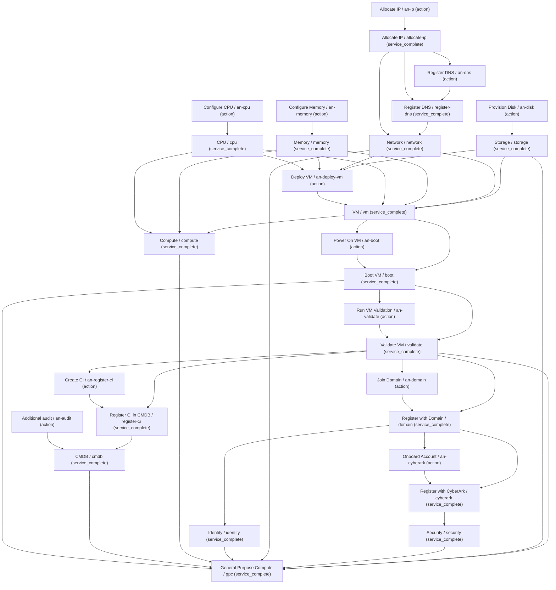

# SMV: VALID — derived Execution DAG

Service vertices are completion milestones; Atomic Nodes are actions. No automation was executed.

## Derived parallel layers

1. an-audit, an-cpu, an-disk, an-ip, an-memory
2. allocate-ip, cpu, memory, storage
3. an-dns
4. register-dns
5. network
6. an-deploy-vm
7. vm
8. an-boot, compute
9. boot
10. an-validate
11. validate
12. an-domain, an-register-ci
13. domain, register-ci
14. an-cyberark, cmdb, identity
15. cyberark
16. security
17. gpc

## Resolved automation (not executed)

- an-audit: `f15db5bf-ddea-566f-9f5c-2ac081794a5f` → `poc-03/automation/artifacts/an-register-ci.py` at `de7dc01244a43cb68dfcfea5f5b6d5b098ac8885`; SHA-256 `ecb9e7e1d529e6f0a1481d4b701a1427e2a97ba2d42fda2995749201268b0f96`
- an-boot: `54af18cc-31eb-5c4a-804d-d68a1caea269` → `poc-03/automation/artifacts/an-boot.py` at `de7dc01244a43cb68dfcfea5f5b6d5b098ac8885`; SHA-256 `6f91668dd76fb3122f92436cd1afaf055ce7bfc222a4a4b31ee4f9cc5bff444b`
- an-cpu: `d2bf2f4e-8b53-5942-ade4-75796bc252c9` → `poc-03/automation/artifacts/an-cpu.py` at `de7dc01244a43cb68dfcfea5f5b6d5b098ac8885`; SHA-256 `dda45c0197594b11972216c628a91745a0dab4aba70206653e98babc57db7fc9`
- an-cyberark: `ac242887-89b7-55b0-b1d8-500c57748d16` → `poc-03/automation/artifacts/an-cyberark.py` at `de7dc01244a43cb68dfcfea5f5b6d5b098ac8885`; SHA-256 `1cbc7374f3d435335b03308c677f83769342bab45e9281c31da39fd83cac63c1`
- an-deploy-vm: `39c45414-d3c4-5596-964d-3f7821a645e9` → `poc-03/automation/artifacts/an-deploy-vm.py` at `de7dc01244a43cb68dfcfea5f5b6d5b098ac8885`; SHA-256 `903d63490a47e4b3a33ce05a6ca62dd9e74db7ffd6e55a114e6134eb5b3b94e9`
- an-disk: `2124882e-62b0-5f25-9753-ec915164a1c5` → `poc-03/automation/artifacts/an-disk.py` at `de7dc01244a43cb68dfcfea5f5b6d5b098ac8885`; SHA-256 `abb08cf8d1fab169d1b4b266625e51ec224fcd0e095855d801c58bcaef5f0cb9`
- an-dns: `2873ad87-1d8d-5f6c-b130-df639ed139a0` → `poc-03/automation/artifacts/an-dns.py` at `de7dc01244a43cb68dfcfea5f5b6d5b098ac8885`; SHA-256 `65a29c111fcaff9cc5c1d7ac263546ed42300734d013133e516ea6685ae1770a`
- an-domain: `ecf32e26-53b4-58ad-bff4-d070a50846ec` → `poc-03/automation/artifacts/an-domain.py` at `de7dc01244a43cb68dfcfea5f5b6d5b098ac8885`; SHA-256 `cd7a0988978c7ba89bd2da01bb91c65fb52f24de73a1b5d4f684918ccd3f402b`
- an-ip: `271817c4-99f6-5b24-9da0-0db3e508f6a5` → `poc-03/automation/artifacts/an-ip.py` at `de7dc01244a43cb68dfcfea5f5b6d5b098ac8885`; SHA-256 `7d09896b2ec3af43206e982f2818737d6268a628a28f60f3d7f8de00378e7ed2`
- an-memory: `c348ea21-fa84-5209-b3e0-34241c2b652e` → `poc-03/automation/artifacts/an-memory.py` at `de7dc01244a43cb68dfcfea5f5b6d5b098ac8885`; SHA-256 `f52d01cadb634d7756c44646b11aae035a7fd9930938b813530a38b900b51fd9`
- an-register-ci: `f15db5bf-ddea-566f-9f5c-2ac081794a5f` → `poc-03/automation/artifacts/an-register-ci.py` at `de7dc01244a43cb68dfcfea5f5b6d5b098ac8885`; SHA-256 `ecb9e7e1d529e6f0a1481d4b701a1427e2a97ba2d42fda2995749201268b0f96`
- an-validate: `708d3532-08e4-5db8-aced-e1b5ef647006` → `poc-03/automation/artifacts/an-validate.py` at `de7dc01244a43cb68dfcfea5f5b6d5b098ac8885`; SHA-256 `99562dc7c2f380113445645782dbdeee70aa07e12fa2839310924d60c529a909`
