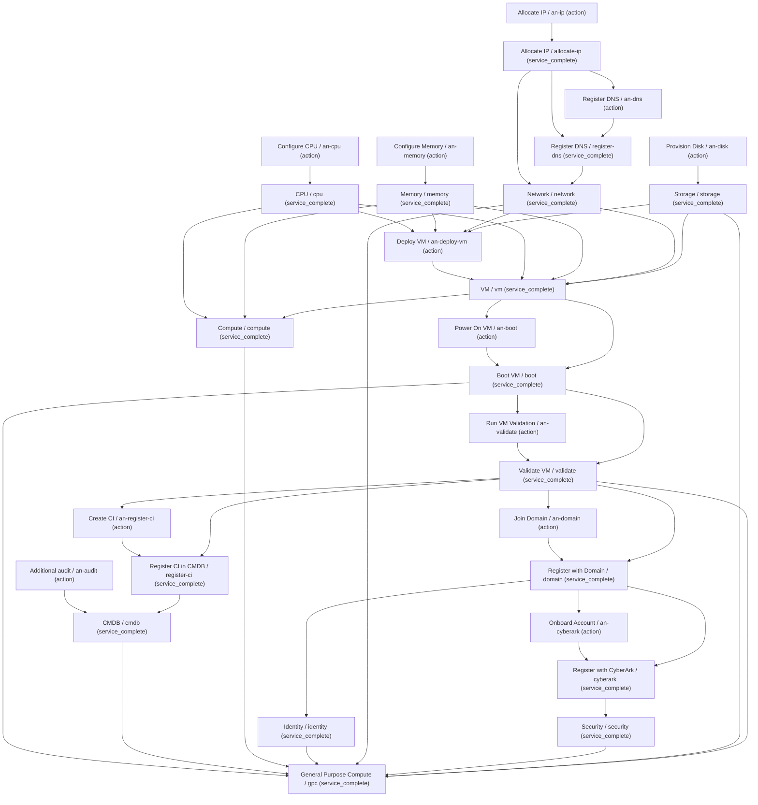

# SMV: VALID — compiled Execution DAG

## Forward and reverse comparison

| Service | Target | Architecture | SME | Status |
|---|---|---|---|---|
| boot | vm | NO | YES | UNMODELED |
| cmdb | register-ci | YES | NO | UNCORROBORATED |
| compute | cpu | YES | NO | UNCORROBORATED |
| compute | memory | YES | NO | UNCORROBORATED |
| compute | vm | YES | NO | UNCORROBORATED |
| cyberark | domain | NO | YES | UNMODELED |
| domain | validate | NO | YES | UNMODELED |
| gpc | allocate-ip | YES | NO | UNCORROBORATED |
| gpc | boot | YES | NO | UNCORROBORATED |
| gpc | cmdb | YES | NO | UNCORROBORATED |
| gpc | compute | YES | YES | CORROBORATED |
| gpc | cpu | YES | NO | UNCORROBORATED |
| gpc | cyberark | YES | NO | UNCORROBORATED |
| gpc | domain | YES | NO | UNCORROBORATED |
| gpc | identity | YES | NO | UNCORROBORATED |
| gpc | memory | YES | NO | UNCORROBORATED |
| gpc | network | YES | NO | UNCORROBORATED |
| gpc | register-ci | YES | NO | UNCORROBORATED |
| gpc | register-dns | YES | NO | UNCORROBORATED |
| gpc | security | YES | NO | UNCORROBORATED |
| gpc | storage | YES | YES | CORROBORATED |
| gpc | validate | YES | NO | UNCORROBORATED |
| gpc | vm | YES | NO | UNCORROBORATED |
| identity | domain | YES | NO | UNCORROBORATED |
| network | allocate-ip | YES | NO | UNCORROBORATED |
| network | register-dns | YES | NO | UNCORROBORATED |
| register-ci | validate | NO | YES | UNMODELED |
| register-dns | allocate-ip | NO | YES | UNMODELED |
| security | cyberark | YES | NO | UNCORROBORATED |
| validate | boot | NO | YES | UNMODELED |
| vm | cpu | NO | YES | UNMODELED |
| vm | memory | NO | YES | UNMODELED |
| vm | network | NO | YES | UNMODELED |
| vm | storage | NO | YES | UNMODELED |

Service vertices are completion milestones; Atomic Nodes are actions. No automation was executed.

## Derived parallel layers

1. an-audit, an-cpu, an-disk, an-ip, an-memory
2. allocate-ip, cpu, memory, storage
3. an-dns
4. register-dns
5. network
6. an-deploy-vm
7. vm
8. an-boot, compute
9. boot
10. an-validate
11. validate
12. an-domain, an-register-ci
13. domain, register-ci
14. an-cyberark, cmdb, identity
15. cyberark
16. security
17. gpc

## Validated automation symbols (linking deferred)

- an-audit: `f15db5bf-ddea-566f-9f5c-2ac081794a5f` (Create CI)
- an-boot: `54af18cc-31eb-5c4a-804d-d68a1caea269` (Power On VM)
- an-cpu: `d2bf2f4e-8b53-5942-ade4-75796bc252c9` (Configure CPU)
- an-cyberark: `ac242887-89b7-55b0-b1d8-500c57748d16` (Onboard Account)
- an-deploy-vm: `39c45414-d3c4-5596-964d-3f7821a645e9` (Deploy VM)
- an-disk: `2124882e-62b0-5f25-9753-ec915164a1c5` (Provision Disk)
- an-dns: `2873ad87-1d8d-5f6c-b130-df639ed139a0` (Register DNS)
- an-domain: `ecf32e26-53b4-58ad-bff4-d070a50846ec` (Join Domain)
- an-ip: `271817c4-99f6-5b24-9da0-0db3e508f6a5` (Allocate IP)
- an-memory: `c348ea21-fa84-5209-b3e0-34241c2b652e` (Configure Memory)
- an-register-ci: `f15db5bf-ddea-566f-9f5c-2ac081794a5f` (Create CI)
- an-validate: `708d3532-08e4-5db8-aced-e1b5ef647006` (Run VM Validation)
